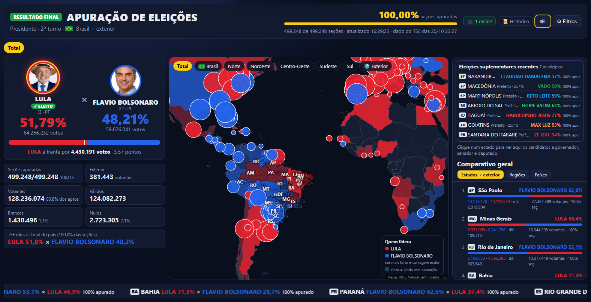
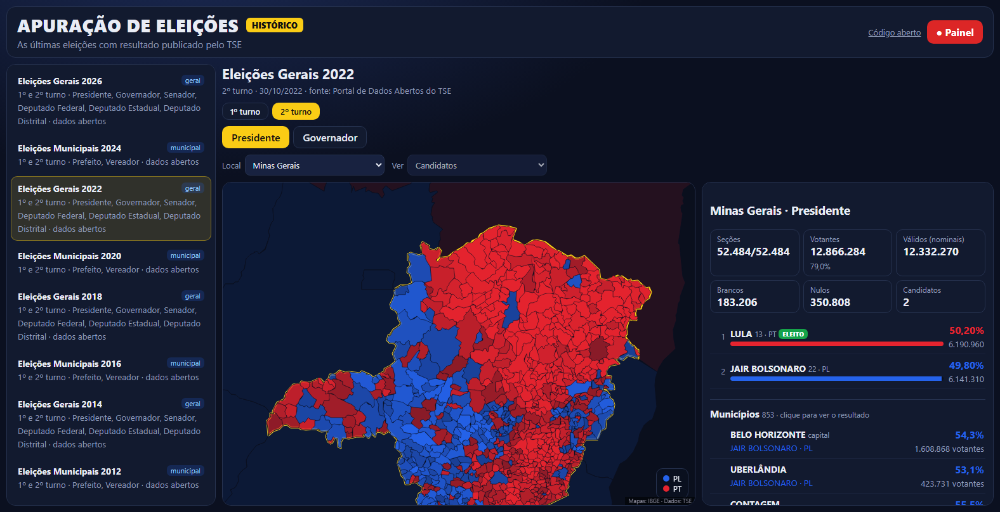
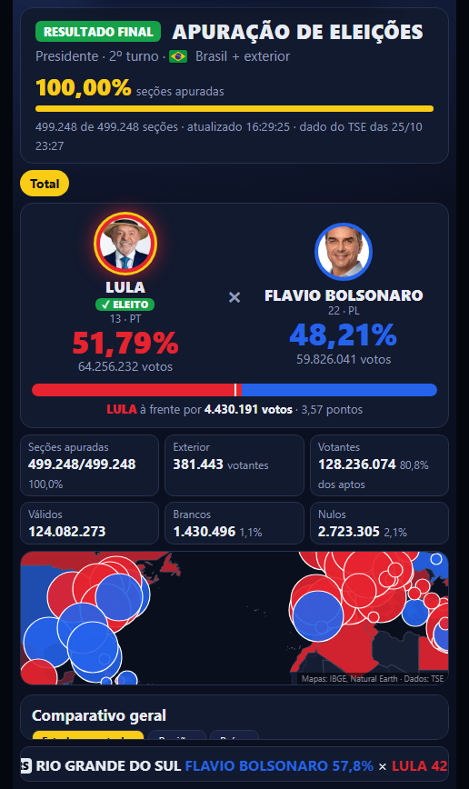
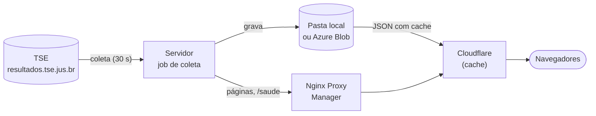
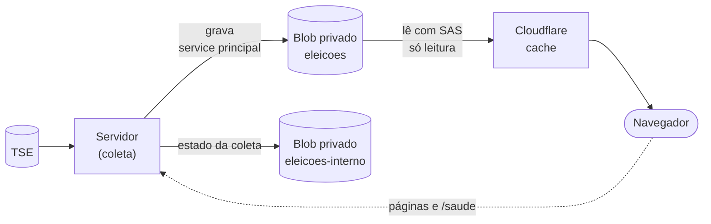
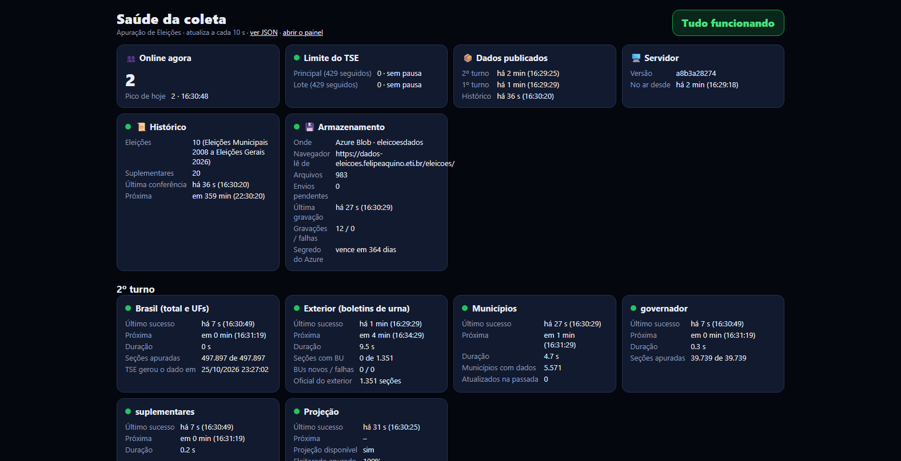

<div align="center">

# 🗳️ Apuração de Eleições

**A apuração do TSE em tempo real, num mapa que qualquer pessoa entende.**
Brasil (estado e município) e exterior (continente, país, cidade e seção) num só lugar, com projeção do resultado, histórico desde 2008 e um modo pensado para lives.

[](https://eleicoes.felipeaquino.eti.br)


[Painel](https://eleicoes.felipeaquino.eti.br) · [Modo TV](https://eleicoes.felipeaquino.eti.br/?modo=tv) · [Modo live](https://eleicoes.felipeaquino.eti.br/?modo=live) · [Histórico](https://eleicoes.felipeaquino.eti.br/historico.html) · [Saúde](https://eleicoes.felipeaquino.eti.br/saude)



</div>

---

## Sumário

- [Por que existe](#por-que-existe)
- [Acesse sem instalar nada](#acesse-sem-instalar-nada)
- [Destaques](#destaques)
- [Como funciona](#como-funciona)
- [Instalação rápida](#instalação-rápida)
- [Configuração](#configuração)
- [Publicar com Nginx Proxy Manager e Cloudflare](#publicar-com-nginx-proxy-manager-e-cloudflare)
- [Armazenamento no Azure Blob (opcional)](#armazenamento-no-azure-blob-opcional)
- [Operação e monitoramento](#operação-e-monitoramento)
- [Histórico das eleições](#histórico-das-eleições)
- [Projeção do resultado](#projeção-do-resultado-experimental)
- [Próximas eleições](#próximas-eleições)
- [Solução de problemas](#solução-de-problemas)
- [Referência](#referência)

---

## Por que existe

Os resultados do TSE são públicos, mas acompanhar município por município, ou ver como votaram os brasileiros no exterior, não é simples para a maioria das pessoas. Numa live de apuração, quem transmitia mostrava um painel que só rodava no próprio computador, e os comentários se enchiam de gente pedindo o link.

Este projeto é esse painel, aberto a todos: **no ar para quem só quer acompanhar** e **com o código aberto para quem quer rodar o seu**.

> [!IMPORTANT]
> Os dados são públicos e oficiais (TSE e IBGE), mas este painel **não é um produto do TSE**. Em caso de divergência, vale o site oficial do TSE.

## Acesse sem instalar nada

**👉 https://eleicoes.felipeaquino.eti.br**: os mesmos recursos deste repositório, sem precisar fazer deploy. O restante deste README é para quem quer rodar a própria instalação.

| Endereço | O que abre |
|---|---|
| [`/`](https://eleicoes.felipeaquino.eti.br) | Painel completo (navegador e celular) |
| [`/?modo=tv`](https://eleicoes.felipeaquino.eti.br/?modo=tv) | Modo TV, com tour automático |
| [`/?modo=live`](https://eleicoes.felipeaquino.eti.br/?modo=live) | Modo live, vertical 9:16 para TikTok e OBS |
| [`/historico.html`](https://eleicoes.felipeaquino.eti.br/historico.html) | Histórico das eleições desde 2008 |
| [`/saude`](https://eleicoes.felipeaquino.eti.br/saude) | Saúde da coleta, em tempo real |

No site público, os dados ficam no Azure Blob e chegam ao navegador pelo cache do Cloudflare ([caminho 2](#caminho-2-regras-do-cloudflare-recomendado)).

> [!NOTE]
> **Repositório público.** Qualquer pessoa pode ler, copiar e rodar o painel. O repositório não guarda credenciais: as configurações do servidor ficam no `.env` e os dados no volume `dados` ou no Azure Blob, e **nada disso vai para o Git** (está no `.gitignore`). Não faça commit de senhas, tokens, certificados ou do `.env`.

## Destaques

<table>
<tr>
<td width="50%" valign="top">

**🗺️ Mapa único, Brasil + exterior**
Clique num estado para ver os municípios, num país para ver as cidades, numa cidade do exterior para ver seção por seção. Placar, estatísticas e ranking mostram sempre a seleção atual.

**📊 Placar que se explica**
À esquerda fica sempre quem está na frente, com a diferença de votos e de pontos. A porcentagem do topo vale para a região selecionada.

**🏛️ Todos os cargos do estado**
Ao selecionar um estado, a coluna da direita mostra governador, senador e deputados, um embaixo do outro, com foto. Também mostra os prefeitos das eleições suplementares do dia.

**🔔 Aviso de dados novos**
Bipe no estilo da urna e um aviso dizendo onde entraram votos, quantos e o placar em cada lugar.

</td>
<td width="50%" valign="top">

**📈 Projeção do resultado final**
No 2º turno: faixa provável e veredito por estado e no total, calculados a partir do 1º turno.

**📜 Histórico desde 2008**
Dez eleições, com mapa por município em presidente, governador, senador e prefeito. Eleições novas entram sozinhas.

**📺 Três modos de exibição**
Completo (navegador e celular), TV (tour automático) e live (vertical 9:16, para transmissão).

**🩺 Página de saúde**
Semáforo da coleta, limite do TSE, pessoas online agora, armazenamento e histórico, atualizados a cada 10 s.

</td>
</tr>
</table>

<div align="center">

&nbsp;

<br><sub>Histórico com detalhamento por município · modo live para transmissão</sub>
</div>

<details>
<summary><b>Todos os recursos do painel</b></summary>

- **Navegação**: `Total › Brasil › Região › Estado › Município` e `Total › Exterior › Continente › País › Cidade › Seção`. Municípios em cinza ainda não têm votos publicados.
- **Filtros**: turno, fonte dos dados do exterior, "ir para" (região, estado, continente, país), busca de município ou cidade, cor do mapa (quem lidera ou % de um candidato), ordenação do ranking, só locais com votos.
- **Diferença de votos**: no placar, nos cards e em cada linha do ranking ("dif.").
- **Governador no 2º turno**: nos estados com 2º turno (em 2026: AC, AM, DF, ES, RN e TO, lidos da configuração do TSE), com candidatos, mapa por município, ranking e letreiro próprios.
- **Candidatos do estado**: governador (ao vivo no 2º turno; senão o resultado do 1º), senador e deputados federal e estadual/distrital (1º turno, com eleitos, bancada por partido e mais votados). Cada card leva ao mapa do cargo ou à lista completa no Histórico (`historico.html#<eleição>/<cargo>/<UF>`).
- **Prefeitos das eleições suplementares do dia**: no Total, as eleições de hoje com quem lidera; no estado, os municípios com disputa; no município, o card do prefeito ao vivo com fotos.
- **Ao vivo ou resultados**: o servidor decide pela data da eleição e pelo andamento da apuração. **AO VIVO** no dia da votação e até 3 dias depois, enquanto não chega a 100%; fora disso, **RESULTADO FINAL**, com **✓ ELEITO** no vencedor e sem projeção nem avisos de apuração.
- **Som**: o navegador só libera som depois de um clique na página, por isso o botão 🔊 pisca até isso acontecer.
- **Atualização automática**: os resultados se atualizam a cada 30 s sem recarregar a página. A cada 5 minutos a página confere a versão do painel (`/versao`). Depois de um deploy, ela recarrega sozinha e volta ao mesmo lugar: filtros, local selecionado, aba do ranking, cargo e tour.
- **Pessoas online**: cada navegador manda um sinal anônimo para `/presenca` a cada 30 s (um id aleatório, sem dados pessoais). O servidor conta quem deu sinal nos últimos 90 s e mostra o número no cabeçalho (👥 N online) e no `/saude`, com o pico do dia. Várias abas do mesmo navegador contam como uma pessoa, e a contagem recomeça do zero quando o container reinicia.

**Modos de exibição**

| Modo | Para quê | Como abrir |
|---|---|---|
| **Completo** (padrão) | Navegador e celular. Horizontal no computador, empilhado no celular | `https://SEU-DOMINIO/` |
| **TV** | Tour automático ligado e botões escondidos. Textos maiores acima de 2200 px | `https://SEU-DOMINIO/?modo=tv` |
| **Live** | Transmissão (TikTok, OBS): vertical 9:16, tour automático, blocos compactos | `https://SEU-DOMINIO/?modo=live` |

Também dá para trocar em ⚙ → *Modo de exibição*, ou com a tecla **L**.

**Atalhos de teclado**

| Tecla | Ação |
|---|---|
| `F` | Abre/fecha os filtros |
| `L` | Alterna entre modo completo e modo live |
| `T` | Liga/desliga o tour automático |
| `S` | Liga/desliga o som |
| `R` | Atualiza agora |
| `Esc` / `Backspace` | Volta ao total / sobe um nível |

</details>

## Como funciona



- **O servidor é o único cliente do TSE.** A cada 30 s ele confere se o TSE publicou dados novos do Brasil, e só então baixa as 27 UFs. O exterior e os boletins de urna rodam a cada 5 min. Os municípios rodam num ciclo à parte e incremental: o arquivo agregado de cada UF diz quais municípios mudaram, e só esses são baixados.
- **Os visitantes leem snapshots**, nunca o TSE. Por isso o número de espectadores não aumenta a carga sobre o TSE, que em dia de eleição responde muito HTTP 429. A coleta tenta de novo com espera crescente e mantém o último dado bom quando algo falha.
- **Os dados ficam na pasta do servidor (padrão) ou no Azure Blob.** Com o Blob, o navegador lê os dados direto da CDN, sem passar pelo servidor ([detalhes](#armazenamento-no-azure-blob-opcional)).
- **Deploy do zero não abre vazio.** Se a eleição do painel já está no histórico embutido, o resultado aparece na hora, e a coleta completa por cima.
- **Sem servidor** (só os arquivos de `public/`, com `servidor.ps1`), o painel percebe que `/saude` não existe e consulta o TSE direto do navegador.

<details>
<summary><b>Fontes de dados do TSE</b></summary>

Tudo vem de `https://resultados.tse.jus.br/oficial/ele2026/`, os mesmos arquivos públicos usados pelo app Resultados do TSE.

| Dado | Arquivo | Quando sai |
|---|---|---|
| Total do país | `<eleição>/dados/br/br-c0001-e<eleição>-u.json` | após as 17h de Brasília |
| Por estado | `<eleição>/dados/<uf>/<uf>-c0001-e<eleição>-u.json` | após as 17h |
| Estatística dos municípios de um estado | `<eleição>/dados/<uf>/<uf>-e<eleição>-ab.json` | após as 17h |
| Por município | `<eleição>/dados/<uf>/<uf><município>-c0001-e<eleição>-u.json` | após as 17h |
| Boletim de urna (BU) de cada seção do exterior | `arquivo-urna/<pleito>/dados/zz/<cidade>/<zona>/<seção>/...` | assim que a seção transmite |

Códigos de 2026: 1º turno = eleição 6257 / pleito 3220; 2º turno = eleição 6258 / pleito 3221; governador no 2º turno = 6260. O exterior usa a "UF" `zz`.

**Fonte dos dados do exterior** (opção nos filtros):
- *Boletins de urna*: o BU é o arquivo assinado que cada urna gera ao fechar a votação. O painel decodifica o formato binário (ASN.1) e soma os votos seção por seção, então o exterior aparece antes da divulgação oficial.
- *Totalização oficial*: os totais do TSE por cidade do exterior.
- *Automático* (padrão): em cada cidade, usa a fonte com mais seções apuradas.

No Brasil a fonte é sempre a totalização oficial, porque baixar os cerca de 470 mil BUs não é viável. Votos digitados em número inexistente contam como nulos, como na totalização oficial.

</details>

## Instalação rápida

> **Pré-requisitos:** Docker com Compose e um [Nginx Proxy Manager](https://nginxproxymanager.com/) na mesma máquina. Funciona em x86 e em ARM (Oracle Ampere, AWS Graviton, Raspberry Pi 4/5).

```bash
git clone https://github.com/felipeaquinoti08/eleicoes.git && cd eleicoes
docker network ls                       # descubra a rede do NPM (ex.: npm_default)
cp .env.example .env                    # e ponha esse nome em NPM_REDE
docker compose -p eleicoes up -d --build
docker compose -p eleicoes logs -f painel
```

O container não publica porta no host: ele entra na rede do NPM, e só o NPM o acessa. Em seguida, [publique com o NPM e o Cloudflare](#publicar-com-nginx-proxy-manager-e-cloudflare) e confira o `/saude`.

<details>
<summary><b>Rodar na sua máquina, sem Docker (Windows)</b></summary>

Clique duas vezes em **`INICIAR.bat`**. Na primeira vez ele baixa um Node.js portátil para a pasta `runtime\` (nada é instalado no sistema), sobe o servidor com a coleta e abre http://localhost:8080.

Alternativa mais leve: `powershell -ExecutionPolicy Bypass -File servidor.ps1` serve só o site, e o navegador consulta o TSE direto (sem coleta e sem municípios em lote).

</details>

<details>
<summary><b>ARM, x86 e imagens multiarquitetura</b></summary>

A imagem base `node:22-alpine` é publicada para **amd64**, **arm64** e **arm/v7**, e o app é JavaScript puro, sem dependências nativas. `docker compose up -d --build` gera a imagem da arquitetura da própria máquina, sem nenhuma mudança.

Para publicar num registry uma imagem que rode nas duas:
```bash
docker buildx create --use
docker buildx build --platform linux/amd64,linux/arm64 -t SEU_REGISTRY/apuracao-eleicoes:latest --push .
```

Se o Alpine der problema em alguma placa ARM: `docker compose build --build-arg NODE_IMAGE=node:22-bookworm-slim`.

</details>

## Configuração

### Variáveis do `docker-compose.yml`

| Variável | Padrão | Uso |
|---|---|---|
| `SYNC_BRASIL_S` | `30` | Intervalo, em segundos, para conferir se o TSE publicou dados novos do Brasil e do governador. As UFs só são baixadas quando há novidade |
| `SYNC_INTERVALO_MIN` | `5` | Intervalo da coleta dos boletins de urna do exterior |
| `TURNOS` | `2,1` | Turnos sincronizados (o 1º turno, já encerrado, a cada 60 min) |
| `TURNOS_MUN` | `2,1` | Turnos com resultado por município |
| `GOVERNADOR` | `1` | `0` desliga a coleta do 2º turno para governador |
| `SUPLEMENTARES` | `1` | `0` desliga a coleta das eleições suplementares do dia |
| `SUPLEMENTARES_DIAS` | `7` | Por quantos dias as suplementares continuam no painel |
| `CACHE_DADOS_S` | `15` | `max-age`/`s-maxage` dos snapshots da apuração |
| `CONCORRENCIA` | `4` | Downloads simultâneos ao TSE. Se o `/saude` mostrar muitos 429, baixe para 2 |
| `HISTORICO` | `1` | `0` desliga o download do histórico |
| `HISTORICO_QTD` | `20` | Quantas eleições suplementares entram no histórico |
| `PORTA` | `8080` | Porta do servidor dentro do container |

### Variáveis do `.env` (nunca vão para o Git)

| Variável | Obrigatória | Uso |
|---|---|---|
| `NPM_REDE` | ✅ | Rede Docker do Nginx Proxy Manager |
| `DADOS` | | Pasta absoluta do servidor no lugar do volume (modo local) |
| `AZURE_*` | | Armazenamento no Azure Blob ([detalhes](#armazenamento-no-azure-blob-opcional)) |
| `DADOS_URL_PUBLICA` | | De onde o navegador lê os dados (CDN). Vazio = `/dados/` do próprio servidor |

### Dados persistentes entre deploys (modo local)

> [!TIP]
> Com o [Azure Blob](#armazenamento-no-azure-blob-opcional), a persistência fica no Blob e o volume não é usado.

Os resultados ficam no **volume Docker `<projeto>_dados`** (com `-p eleicoes`, `eleicoes_dados`). O volume sobrevive a `git pull`, rebuild e redeploy, e o servidor entrega o que já está nele assim que sobe:
```
servindo dados já gravados imediatamente: turno-2.json (2026-10-25T20:51:57Z), …, 32 arquivos de municípios
```

> [!WARNING]
> - Use sempre o mesmo nome de projeto (`-p eleicoes`): outro nome cria outro volume, vazio.
> - Não use `docker compose down -v`: o `-v` apaga o volume.
> - Para guardar numa pasta do servidor, defina `DADOS=/caminho/absoluto` no `.env`, **fora** da pasta do projeto. Ferramentas de deploy costumam recriar a pasta do projeto e apagariam os dados.

Para ver o conteúdo do volume: `docker run --rm -v eleicoes_dados:/d alpine ls -la /d`. O container começa como root só para acertar o dono da pasta de dados, e em seguida o servidor passa a rodar como o usuário `node` (uid 1000).

## Publicar com Nginx Proxy Manager e Cloudflare

Caminho: visitante → Cloudflare → Nginx Proxy Manager → container.

**1. No NPM**, crie um *Proxy Host*:
- *Domain Names*: o seu domínio · *Scheme* `http` · *Forward Hostname* `apuracao-eleicoes` · *Forward Port* `8080`
- **Cache Assets: desligado.** Essa opção força cache longo em `.js`/`.css`, e o visitante ficaria com a versão antiga do painel. O próprio app já envia os cabeçalhos de cache certos.
- *Block Common Exploits*: pode ligar. *Websockets*: não precisa.
- Aba *SSL*: o certificado de origem do Cloudflare (ou Let's Encrypt), com *Force SSL*.

**2. No Cloudflare**, uma *Cache Rule* para os dados servidos pelo próprio servidor (modo local):
- *Quando*: `URI Path` começa com `/dados/`
- *Então*: **Qualificado para cache**. *TTL da borda*: **Use o cabeçalho de controle de cache, se presente, e ignore o cache, caso contrário** (sem TTL fixo nem TTL por código de status).

O Cloudflare não faz cache de `.json` por padrão. Com essa regra, cada ponto de presença busca os resultados no servidor no máximo uma vez a cada 15 s, não importa quantas pessoas estejam assistindo.

**3. Ajuste obrigatório: Browser Cache TTL.** Em *Caching → Configuration → Browser Cache TTL*, escolha **Respect Existing Headers**. O padrão (4 horas) sobrescreve o `Cache-Control` do app e faz o navegador guardar arquivos velhos por horas.

**Conferir:**
```bash
curl -sI https://SEU-DOMINIO/dados/turno-2.json | grep -i cf-cache-status   # MISS e depois HIT (DYNAMIC = regra não pegou)
curl -sI https://SEU-DOMINIO/app.js | grep -i cache-control                # max-age=300, e não 14400
```

O HTML sai sem cache e com `?v=<versão>` em cada `.js`/`.css`, então o navegador sempre pega a versão nova depois de um deploy.

## Armazenamento no Azure Blob (opcional)

Com o Azure Blob, o servidor só **coleta e grava**. Quem lê os dados é o **navegador**, direto do Blob, com o Cloudflare fazendo cache na frente. O tráfego dos visitantes deixa de passar pelo servidor, e nada fica gravado no container.



### Escolha o seu caminho

| Caminho | Para quem | O que precisa |
|---|---|---|
| **1. Local** (padrão) | Quem não quer Azure | Nada: volume Docker |
| **2. Azure + regras do Cloudflare** ⭐ | Domínio no Cloudflare, **inclusive no plano Free** | Domínio personalizado no Blob + 4 regras gratuitas |
| **3. Azure + Cloudflare Worker** | Quem não pode usar domínio personalizado no Blob | O Worker de [`cloudflare/worker.js`](cloudflare/worker.js) |
| **4. Azure sem Cloudflare** | Quem não usa ou não pode mexer no Cloudflare | Só o Azure; o servidor repassa o Blob (dá para pôr cache no Nginx) |

Nos caminhos 2 a 4, o container do Blob é **privado**: ninguém lê direto de `*.blob.core.windows.net`, então todo o tráfego passa pelo cache e o custo de saída do Azure fica previsível.

### Segurança: o que fica onde

| Credencial | Onde fica | O que permite |
|---|---|---|
| Service principal (`AZURE_CLIENT_SECRET`) | Só no `.env` do servidor | Ler, criar e sobrescrever blobs nos dois containers. **Não apaga nada** (papel personalizado `Eleicoes Gravador Blob`) |
| SAS de leitura | Só no Cloudflare (regra ou secret do Worker) | Ler o container público. Não lista, não grava e não alcança o interno. Revogável apagando a política `leitura-cdn` |
| Chaves da storage account | Só no Azure | Não são usadas em lugar nenhum. Ficam ativas só porque assinam o SAS |

- O servidor nunca escreve o segredo nem o token nos logs ou no `/saude`. Uma falha de login aparece só como `Entra ID recusou o login do service principal (HTTP 401, invalid_client)`.
- Lixeira de 30 dias e versionamento ativos: nada sobrescrito ou apagado se perde. As versões com mais de 7 dias são apagadas pelo próprio Azure, porque o snapshot da apuração é regravado a cada 30 s.
- O segredo vale 1 ano. Com `AZURE_CLIENT_SECRET_EXPIRA`, o `/saude` avisa 30 dias antes.
- Cada arquivo vai comprimido (gzip) e com o seu `Cache-Control`:

| Arquivos | Cache |
|---|---|
| Apuração (`turno-*.json`, `gov-2.json`, `sup-hoje.json`, `projecao-2.json`) | 15 s (`CACHE_DADOS_S`) |
| Índice do histórico | 60 s |
| Eleições do histórico | 1 h |
| Detalhamento por município do histórico | 1 dia |
| Fotos | 7 dias |

### Passo 1: criar o armazenamento no Azure

No [Azure Cloud Shell](https://shell.azure.com) (Bash), com este repositório clonado:

```bash
CONTA=<nome-da-conta> RG=rg-eleicoes LOCAL=brazilsouth bash azure/configurar.sh
```

O script cria a storage account (privada, só HTTPS e TLS 1.2+), a lixeira, o versionamento, o ciclo de vida, os dois containers, o papel personalizado, o service principal e o SAS de leitura. No final ele mostra as linhas do `.env` e o SAS para o Cloudflare.

Rodar de novo é seguro: as configurações são reaplicadas sem perder dados, e o segredo atual é mantido. Para trocar o segredo, rode com `RESETAR_SEGREDO=1`.

<details>
<summary>Prefere fazer pelo portal?</summary>

1. **Storage account**: StorageV2, LRS. "Permitir acesso anônimo ao Blob" **desativado**, "Transferência segura" ativada, TLS mínimo 1.2.
2. **Proteção de dados**: exclusão temporária de blobs e contêineres (30 dias) e controle de versão.
3. **Ciclo de vida**: excluir versões anteriores com mais de 7 dias ([`azure/ciclo-de-vida.json`](azure/ciclo-de-vida.json)).
4. **Contêineres** `eleicoes` e `eleicoes-interno`, acesso **Privado**.
5. **Papel personalizado** a partir de [`azure/papel-gravador.json`](azure/papel-gravador.json) (troque `SUBSCRIPTION_ID`).
6. **Registro de aplicativo** no Entra ID → *Certificados e segredos* → segredo de 12 meses.
7. Em cada contêiner → *Controle de acesso (IAM)*: papel `Eleicoes Gravador Blob` para o aplicativo.
8. No contêiner `eleicoes` → *Política de acesso*: `leitura-cdn`, só **Leitura**, 1 ano. Depois *Gerar SAS* com essa política, só HTTPS.

</details>

### Passo 2: ligar o Cloudflare ao Blob

#### Caminho 2: regras do Cloudflare (recomendado)

Funciona no **plano Free**. O Free não deixa reescrever o Host (Origin Rule), então quem passa a aceitar o seu subdomínio é o Azure, com o **domínio personalizado** da storage account.

> [!WARNING]
> **Use um subdomínio de um nível só**, como `dados-eleicoes.seu-dominio` e não `dados.eleicoes.seu-dominio`. O certificado grátis do Cloudflare cobre só `*.seu-dominio`. Com dois níveis, o HTTPS falha no handshake.

**DNS** (dois `CNAME`):

| Nome | Destino | Proxy |
|---|---|---|
| `asverify.dados-eleicoes` | `asverify.<conta>.blob.core.windows.net` | Desligado (cinza) |
| `dados-eleicoes` | `<conta>.blob.core.windows.net` | **Ligado** (laranja) |

**Domínio personalizado no Azure**, depois que o DNS propagar:
```bash
az storage account update -g rg-eleicoes -n <conta> --custom-domain dados-eleicoes.seu-dominio --use-subdomain true
```

**Quatro regras** em *Regras → Visão geral → Criar regra*, todas com a expressão `(http.host eq "dados-eleicoes.seu-dominio")`:

| # | Tipo de regra | Nome | Configuração |
|---|---|---|---|
| 1 | **Regra de Configuração** | `dados - SSL Full` | SSL → **Completo** (*Full*, não *Full strict*: o certificado do Azure é `*.blob.core.windows.net`). A conexão continua criptografada |
| 2 | **Regra de Reescrita de URL** | `dados - SAS` | Caminho: **Preservar** · Consulta: **Reescrever para → Estático** → o SAS, sem o `?`. O SAS nunca chega ao navegador, e query strings inventadas não furam o cache |
| 3 | **Regra de Transformação de Cabeçalho de Resposta** | `dados - CORS` | Definir estático `Access-Control-Allow-Origin` = `https://eleicoes.seu-dominio` |
| 4 | **Regra de Cache** | `dados - cache` | **Qualificado para cache** · TTL da borda: **usar cache-control se presente** · TTL do navegador: **respeitar a origem** · Código de status 404: **Sem armazenamento** |

No `.env`: `DADOS_URL_PUBLICA=https://dados-eleicoes.seu-dominio/eleicoes/` (com o nome do container no fim).

> Em planos pagos, que reescrevem Host e SNI, dá para trocar o DNS e o domínio personalizado por uma Origin Rule (Host e SNI = `<conta>.blob.core.windows.net`) com SSL *Full (strict)*.

#### Caminho 3: Cloudflare Worker

1. **Workers & Pages → Create → Worker**: cole [`cloudflare/worker.js`](cloudflare/worker.js).
2. **Settings → Variables**: `AZURE_STORAGE_ACCOUNT`, `AZURE_CONTAINER` (`eleicoes`), `ORIGEM_PERMITIDA` (`https://eleicoes.seu-dominio`) e, como **Secret**, `AZURE_SAS`.
3. **Domains & Routes**: `dados-eleicoes.seu-dominio`.
4. No `.env`: `DADOS_URL_PUBLICA=https://dados-eleicoes.seu-dominio/` (sem o container; o Worker já o acrescenta).

> [!CAUTION]
> O Worker roda em **toda** requisição, mesmo nas atendidas pelo cache. O plano grátis (100 mil por dia) acaba em poucas horas num dia de apuração. Use o plano pago do Workers ou o caminho 2.

#### Caminho 4: sem Cloudflare

Deixe `DADOS_URL_PUBLICA` vazio. O navegador continua pedindo `/dados/...` ao servidor, que busca no Blob e repassa com o mesmo `Cache-Control`. Para aliviar o servidor, ponha cache no Nginx Proxy Manager:

<details>
<summary>Configuração de cache no NPM</summary>

`/data/nginx/custom/http_top.conf`:
```nginx
proxy_cache_path /data/nginx/cache/eleicoes levels=1:2 keys_zone=eleicoes:10m max_size=500m inactive=1h;
```

Proxy host do painel → **Advanced**:
```nginx
location /dados/ {
  proxy_pass http://apuracao-eleicoes:8080;
  proxy_cache eleicoes;
  proxy_cache_valid 200 15s;
  proxy_cache_valid 404 15s;
  proxy_cache_lock on;
  proxy_cache_use_stale updating error timeout;
  add_header X-Cache $upstream_cache_status;
}
```

</details>

Outra CDN também serve, se conseguir acrescentar uma query string fixa (o SAS) às requisições para a origem e fazer cache respeitando o `Cache-Control`. **Não torne o container público:** qualquer pessoa poderia chamar o Blob direto, fora do cache, e a conta de tráfego seria sua.

### Passo 3: levar os dados já coletados (se já rodava no modo local)

Antes do primeiro deploy com Azure, copie o volume para o Blob. Sem isso, o servidor começa vazio e baixa do TSE todos os municípios de novo, o que gera uma onda de HTTP 429 até a carga terminar (em geral menos de uma hora).

```bash
docker compose -p eleicoes run --rm --no-deps -v eleicoes_dados:/migrar painel node server/migrar-para-azure.js /migrar
```

O script não sobrescreve o que já estiver no Blob e pode ser rodado de novo. Se o Blob já tiver um estado parcial, pare o container e use `--sobrescrever`.

### Passo 4: ligar no servidor

Preencha no `.env` as linhas do script e o `DADOS_URL_PUBLICA`, e faça o redeploy. O log deve mostrar:
```
painel em http://0.0.0.0:8080/ (dados: Azure Blob, lidos pelo navegador em https://dados-eleicoes.seu-dominio/eleicoes/)
[armazenamento] Azure Blob (<conta>): N arquivos, estado da coleta carregado (N arquivos)
[histórico] base embutida enviada ao Azure Blob: 877 arquivos      ← só na primeira vez
```

**Conferir de fora:**
```bash
curl -sI https://dados-eleicoes.seu-dominio/eleicoes/turno-2.json | grep -iE "^HTTP|cf-cache-status|access-control"
# 200 + access-control-allow-origin; a partir da 2ª chamada, cf-cache-status: HIT
curl -sI https://dados-eleicoes.seu-dominio/eleicoes-interno/cache-mun-2.json | head -1
# 403: o estado interno não é acessível pela CDN
```

| Situação | O que fazer |
|---|---|
| Azure fora do ar | Nada: a coleta continua e as gravações esperam numa fila com novas tentativas (o `/saude` mostra os pendentes) |
| Voltar ao modo local | Apagar `AZURE_*` e `DADOS_URL_PUBLICA` do `.env` e fazer o redeploy |
| Trocar o segredo | `RESETAR_SEGREDO=1 ... bash azure/configurar.sh`, atualizar o `.env` e fazer o redeploy |
| Revogar o SAS | Apagar a política `leitura-cdn` do container e gerar outra |
| Volume antigo | Depois de alguns dias funcionando: `docker volume rm eleicoes_dados` |

**Testar sem conta no Azure:** `node tools/simular-azure.js 10099` sobe um simulador do Entra ID e do Blob. Rode o servidor com `AZURE_BLOB_ENDPOINT=http://127.0.0.1:10099 AZURE_AUTHORITY=http://127.0.0.1:10099 AZURE_STORAGE_ACCOUNT=teste AZURE_TENANT_ID=t AZURE_CLIENT_ID=c AZURE_CLIENT_SECRET=segredo-de-teste`.

## Operação e monitoramento



**`/saude`** é uma página legível no navegador (nunca fica em cache) e se atualiza a cada 10 s. Ela mostra:
- semáforo geral e pessoas online, com o pico do dia;
- limite do TSE (429) e dados publicados;
- histórico e armazenamento;
- o estado de cada coleta.

Scripts e o healthcheck recebem o mesmo conteúdo em JSON (`/saude.json`). Em cada coleta:

| Campo | O que indica |
|---|---|
| `ok` / `erro` | Se a última passada deu certo, e o erro quando não deu |
| `ultimoSucesso` / `proxima` | Quando rodou pela última vez e quando roda de novo |
| `rodando` | `true` enquanto a passada está em andamento |
| `secoesApuradas`, `secoesComBU`, `municipiosComDados` | Quanto já foi coletado |
| `tseGeradoEm` | Horário em que o **TSE** gerou o dado (Brasília) |

Se `ultimoSucesso` avança a cada ciclo, a coleta está funcionando. Se `secoesApuradas` não muda e `tseGeradoEm` também não, é o TSE que ainda não publicou dados novos.

**Logs** (`docker compose -p eleicoes logs -f painel`):
```
turno 2: Brasil 214 seções nas UFs em 1.0s
turno 2: exterior 775/1351 seções com BU (0 novos, 0 falhas), oficial 0/1351 em 0.6s
turno 2: municípios 49 atualizados, 0 falhas em 2s
```
Linhas `aviso: 429 …` são normais em dia de eleição, e a coleta tenta de novo sozinha. Preocupe-se só com `erro …` repetido em vários ciclos.

## Histórico das eleições

A página **📜 Histórico** é organizada **por eleição**, com abas de turno e de cargo:

| Eleição | Cargos | Fonte |
|---|---|---|
| Gerais 2026, 2022, 2018, 2014, 2010 | Presidente (Brasil, estados e exterior), Governador, Senador, Deputados Federal, Estadual e Distrital | Dados Abertos do TSE · 2º turno de 2026: coleta ao vivo do painel |
| Municipais 2024, 2020, 2016, 2012, 2008 | Prefeito (todos os municípios) e Vereador (capitais) | Dados Abertos do TSE |
| Suplementares | As 20 mais recentes, num grupo à parte | Sistema de resultados do TSE |

- **Detalhamento por município**, igual ao do painel ao vivo, em Presidente, Governador, Senador e Prefeito:
  - clicar num estado abre o mapa dos municípios, na cor do partido mais votado (mais forte quanto maior a vantagem), e a lista de municípios na coluna da direita;
  - clicar num município mostra o resultado completo dele, e o botão **←** volta ao estado;
  - em Prefeito, o filtro de local tem **Todos os municípios do estado**;
  - deputados e vereadores ficam por estado e capital, porque são centenas de candidatos por município.
- **Eleições novas entram sozinhas.** A cada 6 horas o servidor confere a configuração do TSE. Uma eleição ordinária nova é baixada e entra no histórico quando a apuração termina, junto com o detalhamento municipal gerado da coleta ao vivo.
- **Já vem pronto na imagem.** `server/historico-base/` tem cerca de 3 MB de eleições e 17 MB de municípios. O histórico aparece assim que o container sobe, sem depender do TSE, e o navegador só baixa os municípios de um estado quando ele é aberto.
- **Conferido com os resultados oficiais:**
  - 2022: Lula 50,90% no 2º turno;
  - 2018: Bolsonaro 55,13%;
  - 2014: Dilma 51,64%;
  - 2010: Dilma 56,05%;
  - São Paulo 2008: Kassab 60,72%.

<details>
<summary>Atualizar a base com os Dados Abertos do TSE</summary>

O sistema de resultados do TSE só publica os ciclos 2024 e 2026, por isso o histórico vem dos Dados Abertos, que também trazem o resultado por município.

```bash
# zips de https://cdn.tse.jus.br/estatistica/sead/odsele/votacao_candidato_munzona/ e .../detalhe_votacao_munzona/
node tools/importar-dados-abertos.js <pasta-com-os-zips> 2022 2020 2018
```

</details>

## Projeção do resultado (experimental)

No 2º turno, o placar mostra uma **projeção do resultado final** para o Total, o Brasil e cada estado, com faixa provável e veredito.

- **Modelo**: cada local apurado no 2º turno é comparado com ele mesmo no 1º turno. No Brasil a comparação é município a município; no exterior, seção a seção, pelos boletins de urna.
  - Por estado, separando capital e interior, o modelo mede quanto cada candidato variou em relação ao 1º turno. Essa variação já inclui a transferência de votos e a mudança de comparecimento, e é aplicada ao que falta apurar.
  - Onde há pouca coisa apurada, o modelo usa a variação do estado, da região ou do país.
- **Faixa provável**: reamostragem dos locais apurados (intervalo de 90%), mais uma margem mínima de 3 pontos com nada apurado, que cai até zero com tudo apurado.
- **Veredito**: só aponta vencedor quando a faixa inteira fica de um lado dos 50%. A projeção aparece depois de 2% do eleitorado apurado.
- **Limitação**: ainda não foi validada com apurações reais anteriores. Num teste simulado com apuração fora de ordem, o erro foi de cerca de 1 ponto com 10% apurado e quase zero a partir de 20%, mas simulações tendem a ser otimistas.
- Roda no servidor (`server/projecao.js`) a cada passada da coleta. Desligue em ⚙ → *Projeção*.

## Próximas eleições

| Parte | Automática? |
|---|---|
| **Histórico** | ✅ Sim. Eleições novas (2028, 2030…) são descobertas na configuração do TSE e entram sozinhas quando a apuração termina |
| **Suplementares do dia** | ✅ Sim. São lidas da configuração do TSE, em qualquer ano |
| **Ao vivo ou resultados** | ✅ Sim. O modo é decidido pela data e pelo andamento da apuração |
| **Painel ao vivo de uma eleição geral** (2030) | ⚠️ Precisa de ajuste. Os códigos da eleição (ciclo `ele2026`, eleições 6257/6258/6260, pleitos 3220/3221) estão fixos em `public/app.js`, `server/sync.js`, `server/governador.js` e `public/outros-cargos.js` |
| **Painel ao vivo de uma eleição municipal** (2028) | ❌ Precisa de um modo novo. O painel ao vivo foi feito para presidente (Brasil + exterior); numa municipal não há presidente nem voto no exterior, e a disputa é por prefeito em cada município |

## Solução de problemas

<details>
<summary><b>Muitos <code>aviso: 429</code> nos logs</b></summary>

O TSE limita requisições em dia de eleição e numa carga do zero (volume ou Blob vazios). A coleta espera e tenta de novo sozinha, e o card **Limite do TSE** do `/saude` mostra a pausa. Se durar muito, baixe `CONCORRENCIA` para 2. Ao migrar para o Azure, use o [passo 3](#passo-3-levar-os-dados-já-coletados-se-já-rodava-no-modo-local) para não recomeçar do zero.

</details>

<details>
<summary><b>Painel abre com versão antiga ou quebrado depois de um deploy</b></summary>

Confira o *Browser Cache TTL* = **Respect Existing Headers** no Cloudflare e o *Cache Assets* desligado no NPM. Para limpar o que ficou preso: *Caching → Configuration → Purge Everything*.

</details>

<details>
<summary><b>Subdomínio dos dados: erro de handshake, 526, 403 ou 404</b></summary>

| Sintoma | Causa |
|---|---|
| Handshake falha (`SEC_E_ILLEGAL_MESSAGE`, `ERR_SSL_VERSION_OR_CIPHER_MISMATCH`) | Subdomínio com dois níveis: use `dados-eleicoes.seu-dominio` |
| `526` | A regra de SSL **Completo** não está pegando (continua *strict*) |
| `400` / `InvalidUri` | O domínio personalizado não foi registrado na storage account |
| `403 AuthenticationFailed` no container público | O SAS não está sendo aplicado: confira a regra de reescrita (sem `?`, caminho preservado) |
| `404 BlobNotFound` | Está tudo ligado, mas o arquivo ainda não existe: falta o redeploy com `AZURE_*` |
| Painel sem dados, com erro de CORS no console | Falta a regra de `Access-Control-Allow-Origin`, ou ela tem outro endereço |

</details>

<details>
<summary><b><code>Entra ID recusou o login do service principal</code></b></summary>

O segredo do `.env` não é o atual, provavelmente porque foi trocado ao rodar o script de novo com `RESETAR_SEGREDO=1` ou por uma versão antiga dele. Gere um novo e atualize o `.env`.

</details>

<details>
<summary><b>Os dados sumiram depois de um redeploy (modo local)</b></summary>

Provavelmente o nome do projeto mudou (outro volume) ou foi usado `down -v`. Liste com `docker volume ls`: o volume antigo, com os dados, continua lá.

</details>

## Referência

<details>
<summary><b>Estrutura do repositório</b></summary>

```
public/                     site estático
  index.html, app.js        painel ao vivo
  governador.js             2º turno para governador
  outros-cargos.js          cards dos outros cargos do estado
  historico.html, .js       histórico com detalhamento municipal
  saude.html                página /saude
  bu.js, som.js             decodificador de boletim de urna e bipe
  geo/, cidades.js, municipios.js   mapas do IBGE, cidades do exterior, municípios
server/
  server.js                 servidor HTTP (site, /saude, /presenca, /versao)
  sync.js                   coleta do TSE (Brasil, exterior, municípios)
  governador.js, suplementares.js, projecao.js
  historico.js              histórico (descobre e baixa eleições novas)
  historico-base/           eleições e municípios embutidos na imagem
  armazenamento.js          pasta local ou Azure Blob
  migrar-para-azure.js      copia o volume local para o Blob
azure/                      script, papel personalizado e ciclo de vida do Azure
cloudflare/worker.js        alternativa às regras do Cloudflare
tools/
  importar-dados-abertos.js gera a base a partir dos Dados Abertos do TSE
  simular-azure.js          simulador do Azure para testes
docs/img/                   capturas de tela deste README
INICIAR.bat, iniciar.ps1    roda localmente com Node portátil (Windows)
```

</details>

**Créditos:** dados do [TSE](https://resultados.tse.jus.br) (resultados e Dados Abertos) · mapas do [IBGE](https://www.ibge.gov.br) e [Natural Earth](https://www.naturalearthdata.com), de uso livre · fotos dos candidatos: TSE · mapas com [Leaflet](https://leafletjs.com).

<div align="center">
<sub>Feito para que todos tenham acesso às informações do TSE. Os dados são públicos; o resultado oficial é sempre o do TSE.</sub>
</div>
